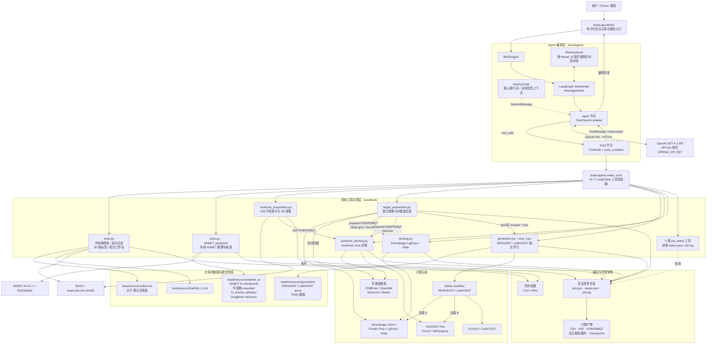
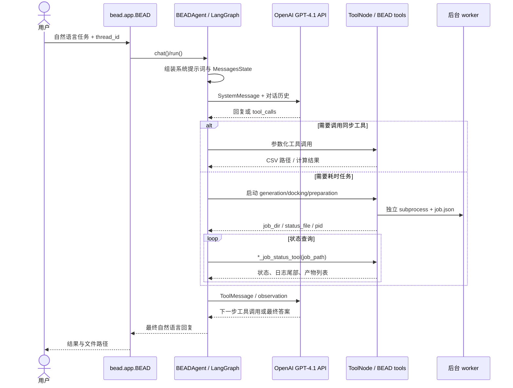

# BEAD 当前仓库架构

> 基于 2026-10-22 工作区中的实际代码生成。实线表示主要运行时调用或数据流，虚线表示配置、资源或状态读取。

## 总体架构图



## Agent 的 ReAct 运行流程



## 活跃工具映射

| Agent 工具 | 主要实现 | 核心输入 | 主要输出/后端 |
|---|---|---|---|
| `Subsearch` / `Rev_subsearch` | `bead/tools/tools.py` | scaffold、CSV | RDKit 子结构过滤 CSV/图片 |
| `Similarity_prediction` | `tools.py` + `utils/sim.py` | reference ID | RDKit ETKDG/MMFF 3D 相似性 CSV |
| `filter_then_similarity_tool` | `tools.py` | ID、scaffold、相似性范围 | 靶点过滤 → 反向过滤 → 3D 相似性 |
| `ADMET_prediction` | `tools.py` | SMILES CSV | 本地 ADMET-AI + 专用半衰期模型 + CL 校准器 |
| `Mol_preparation` | `molecule_preparation.py` | SMILES/InChI/CSV | RDKit/Meeko；SDF、PDB、PDBQT |
| `Target_preparation` | `target_preparation.py` | PDB、可选 box | Schrödinger 或 PDBFixer/OpenMM/Meeko |
| `Denovo_molgen` | `generation.py` | grid 或 receptor/box | REINVENT + Glide/Vina RL；默认 100 epochs |
| `Constrained_molgen` | `generation.py` | scaffold + grid 或 receptor/box | LibINVENT + Glide/Vina RL；默认 1500 epochs |
| `Docking_schrodinger` | `docking.py` | SMILES CSV + Glide grid | LigPrep/Glide、排序与相互作用报告 |
| `Docking_autodock` | `autodock_docking.py` | SMILES CSV + receptor + box | Molscrub/Meeko/Vina/ProLIF |
| 5 个 `*_job_status_tool` | 对应后台模块 | job 目录或 `status.json` | 状态、日志尾部、产物路径 |

## 仓库目录职责

```text
BEAD/
├── bead/
│   ├── app.py                    # 对外入口
│   ├── prompt.py                 # Agent 系统提示词
│   ├── agents/
│   │   ├── agent.py              # LangGraph ReAct 编排、OpenAI GPT-4.1 API 连接
│   │   └── make_tools.py         # LangChain 工具注册与参数接口
│   ├── tools/                    # 化学计算、生成、准备、对接及状态查询
│   ├── utils/sim.py              # 3D 相似性底层实现
│   ├── resources/                # 本地模型、训练后校准器、生成先验
│   └── source/                   # 默认分子库与 scaffold
├── scripts/                      # 数据准备、半衰期/CL 训练与分析脚本
├── vendor/reinvent4/             # 仓库内 REINVENT4 源码副本
├── tests/                        # 测试及 1018 实验运行数据
├── benchmarks/                   # Agent 性能评测
├── setup.py / environment.yml    # Python 3.11 包与环境定义
└── *_TOOL.md                     # 各重型工具的使用文档
```

## 当前实现边界

- 默认大模型是 OpenAI API 的 `gpt-4.1`，凭据从 `OPENAI_API_KEY` 环境变量读取。
- `MemorySaver` 是进程内存记忆；进程退出后不会持久化对话状态。
- 生成、对接、分子准备和靶点准备采用独立后台进程；Agent 通过状态工具读取日志和产物。
- `bead/tools/tools.py` 是当前 Agent 使用的检索、相似性和 ADMET 主实现；`tools h.py`、`tools h2.py`、`tools2.py` 等未注册到当前 `bead_toolset`，属于历史/实验文件。
- Schrödinger 是可选闭源后端；准备和生成支持自动回退到开源栈，独立的 `Docking_schrodinger` 本身仍要求 Schrödinger。
